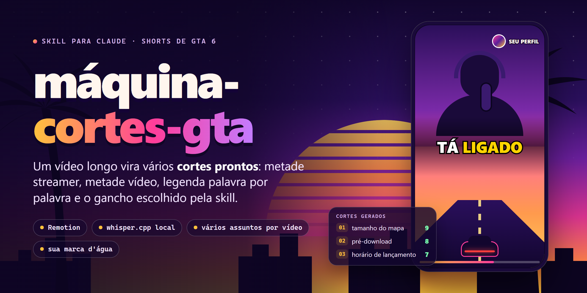

<p align="center">
  
</p>

<p align="center">
  <a href="LICENSE"></a>
  
  
  
  
</p>

# máquina de cortes

Três skills do Claude Code que pegam um vídeo longo ou uma live e entregam **vários cortes prontos para Shorts**, cada um com um **assunto e um gancho diferentes**. Cada tipo de trecho tem a sua skill e o seu layout:

| Skill | Para quê | Layout (1080×1920) |
|---|---|---|
| **`/cortes-papo`** | Podcast, react, opinião, histórias, notícias: gente conversando, sem jogo na tela | Quem fala em cima (50%), **B-roll do assunto** embaixo (50%), legenda na divisa |
| **`/cortes-gameplay`** | Live ou vídeo de jogo: jogadas, reações durante a partida, momentos engraçados | **Webcam** em cima (~38%), **o jogo do mesmo momento** embaixo (~62%), recortado no foco da ação; sem webcam, o jogo em tela cheia |
| **`/cortes-video`** | Vlog, desafio, IRL: a cena é o conteúdo | **Tela cheia**, recortada seguindo a pessoa, legenda no terço inferior |

As três usam o mesmo motor (Remotion + whisper.cpp, em `~/.maquina-cortes-gta`). Numa live mista, cada skill corta só os trechos do seu tipo e avisa onde estão os outros; a transcrição é feita uma vez só.

**Exemplo de pedido:**

> /cortes-gameplay faz os cortes dessa live do Fulano: https://www.youtube.com/watch?v=SEU_VIDEO

## O que elas fazem

| | |
|---|---|
| **Escolha dos cortes** | De 3 a 5 cortes de 20 a 60 s, cada um com um gancho com nota ≥ 6, a partir da transcrição. Os trechos marcados com **🔥 mais reproduzido** (gráfico do YouTube) e **🔊 picos de empolgação** na voz são lidos primeiro. |
| **Aprovação** | Uma tabela de candidatos para você aprovar antes do render. |
| **Mapa visual** | Folhas de miniaturas do vídeo para separar papo, gameplay e cena, e achar a webcam. |
| **Legenda** | Palavra por palavra, na **paleta do streamer**: a cor base no texto, a cor de destaque na palavra falada e nas **palavras-chave**, que também ficam maiores. A paleta é proposta a partir da logo ou do vídeo e salva uma vez por streamer. |
| **Ritmo** | Pausas entre frases encurtadas para ~0,2 s, jump cuts a cada ~3 s com zoom leve, flash e swoosh só nas viradas. |
| **Volume** | −14 LUFS, o padrão do YouTube e do TikTok. |
| **B-roll** (papo, opcional) | Vídeos de apoio do **Pexels** buscados pelo assunto (chave grátis sua), ou arquivos seus. Sem eles, entra a câmera desfocada. |
| **Imagens** (opcional) | Popups com imagem real, buscados pela API do Google ou mandados por você. |
| **Efeitos sonoros** (opcional) | Whoosh, impacto e pop gerados com a ElevenLabs por um gerador embutido ([créditos](THIRD_PARTY.md)). |
| **Marca d'água** (opcional) | A logo e o nome do seu perfil no canto superior direito. |

Cada corte sai em MP4 1080×1920, 30 fps.

## Instalação

Precisa do **Claude Code** e de três programas que a instalação confere:
- **Node.js 18+**, de preferência 22+;
- **FFmpeg**;
- **yt-dlp** atualizado, para aceitar links. No Linux, o do `apt` costuma ser antigo; prefira `pipx install yt-dlp`.

```bash
git clone https://github.com/pedroxcardoso/maquina-cortes-gta.git
cd maquina-cortes-gta
bash instalador/install.sh            # macOS, Linux ou Git Bash
# Windows: powershell -ExecutionPolicy Bypass -File instalador\install.ps1
```

O script copia as três skills para `~/.claude/skills/` e instala o motor em `~/.maquina-cortes-gta`: o Remotion, o Chrome headless dele e o whisper.cpp com o modelo `small`. São alguns minutos e cerca de 1 GB de download.

Para conferir o estado: `node ~/.maquina-cortes-gta/setup.mjs --check`.

### Chaves opcionais (variáveis de ambiente; nunca cole no chat)

| Variável | Para quê |
|---|---|
| `PEXELS_API_KEY` | B-roll em vídeo no `cortes-papo`. Grátis em [pexels.com/api](https://www.pexels.com/api/). |
| `GOOGLE_API_KEY` e `GOOGLE_CSE_ID` | Popups com imagens do Google. Grátis até 100 buscas por dia. |
| `ELEVENLABS_API_KEY` | Gerar os efeitos sonoros uma vez, com créditos da sua conta. |
| `YOUTUBE_CLIENT_ID` e `YOUTUBE_CLIENT_SECRET` | Publicar e agendar no YouTube Shorts. |
| `TIKTOK_CLIENT_KEY` e `TIKTOK_CLIENT_SECRET` | Mandar para os rascunhos do TikTok (ou publicar direto, depois da auditoria do app). |
| `META_APP_ID` e `META_APP_SECRET` | Publicar Reels no Instagram (conta profissional ligada a uma Página). |

### Publicação (opcional)

Depois dos cortes prontos, a skill pode publicar no **YouTube Shorts**, no **TikTok** e no **Instagram Reels** pelas APIs oficiais, com título, descrição, hashtags, capa e horários agendados, sempre depois do seu OK na tabela final. Você cria um app em cada plataforma uma vez e conecta a conta pelo navegador:

```bash
node ~/.maquina-cortes-gta/ferramentas/publicar/publicar.mjs conectar youtube   # ou tiktok, instagram
```

O passo a passo de cada plataforma, os limites e o agendamento estão em [`docs/publicacao.md`](docs/publicacao.md). Os tokens ficam em `~/.maquina-cortes-gta/contas/`, só com acesso do seu usuário.

## Primeiro uso

- **Marca d'água:** a skill pergunta uma vez se você quer uma. Se quiser, pede o nome do perfil e a logo.
- **Paleta:** com um streamer novo, a skill propõe as duas cores da legenda e grava depois do seu OK.

Depois disso, o fluxo é este:
1. você manda o vídeo (link ou arquivo) e diz de quem é;
2. a skill baixa, transcreve, separa os trechos e propõe os cortes;
3. você aprova;
4. ela renderiza;
5. você recebe os MP4s e uma tabela com o gancho e um título sugerido para cada um.

## Como funciona

```
motor/                       projeto Remotion (copiado para ~/.maquina-cortes-gta/engine)
├── scripts/
│   ├── transcribe.mjs       whisper.cpp palavra por palavra, silêncios e picos 🔊
│   ├── transcript-text.mjs  a transcrição como "[mm:ss] frase", com 🔥 e 🔊
│   ├── mapa-visual.mjs      folhas de miniaturas do vídeo
│   ├── cores.mjs            cores mais presentes (para a paleta)
│   ├── buscar-broll.mjs     B-roll do Pexels (opcional)
│   ├── buscar-imagens.mjs   imagens do Google (opcional)
│   └── build.mjs            tira as pausas, monta o layout, renderiza e ajusta o volume
└── src/SplitCut.jsx         os três layouts, a legenda, o zoom e a marca d'água
docs/                        guias das três skills (copiados para ~/.maquina-cortes-gta/docs)
├── preparacao.md            instalação, marca d'água, paleta, download, transcrição e mapa visual
├── ganchos.md               como escolher cortes pelo gancho
├── efeitos-e-imagens.md     ritmo, viradas, popups e efeitos sonoros
├── estilo-referencias.md    o guia de estilo
├── problemas.md             erros comuns
└── publicacao.md            publicação e agendamento nas redes (opcional)
ferramentas/                 copiadas para ~/.maquina-cortes-gta/ferramentas
├── gerar-paleta-sfx.mjs     gera os efeitos sonoros (ElevenLabs), uma vez
├── sfx/                     gerador de efeitos embutido (MIT, ver THIRD_PARTY.md)
└── publicar/                publica e agenda no YouTube, TikTok e Instagram (opcional)
instalador/
├── install.sh / install.ps1 copiam as skills para ~/.claude/skills e rodam o setup
└── setup.mjs                instala e confere; perfil, marca d'água e paletas
skills/                      só as instruções de cada skill
├── cortes-papo/             SKILL.md + references/layout-papo.md
├── cortes-gameplay/         SKILL.md + references/enquadramento-gameplay.md
└── cortes-video/            SKILL.md + references/enquadramento-tela-cheia.md
```

Claude decide **o que cortar e como enquadrar**, olhando a transcrição e os quadros do vídeo. Os scripts fazem o trabalho pesado de forma determinística: transcrever, medir silêncios, remapear as legendas e renderizar.

## Limites

- **Roda no seu computador.** Um corte de 40 s leva cerca de 1 a 2 minutos para renderizar, dependendo da máquina.
- **O enquadramento vem de quadros soltos.** A skill olha miniaturas e escolhe o foco por cena; numa câmera muito rápida, o recorte pode perder a ação. Confira os quadros do resultado.
- **Câmera pequena ampliada fica borrada.** Prefira origem em 1080p ou mais, principalmente no gameplay (webcam) e na tela cheia.
- **Qualidade da legenda:** depende do modelo do whisper. O `small` é o padrão; o `medium` é mais exato e mais pesado.
- **O [Remotion](https://www.remotion.dev/license) tem licença própria:** confira se o seu uso (por exemplo, em empresa) exige licença.

## Aviso

Você é o responsável pelo vídeo que usa como origem e pelo que publica: direitos autorais, termos das plataformas e permissões de quem aparece nele.

## Privacidade

Tudo roda localmente: o vídeo, a transcrição e os cortes ficam no seu computador. A skill só acessa a internet para baixar o vídeo que você indicar (e os dados públicos dele, como o gráfico "mais reproduzido"), instalar as dependências e carregar a fonte da legenda (Google Fonts) na hora do render. Se você configurar as chaves opcionais, ela também chama a API do Pexels (B-roll), a de busca de imagens do Google e a ElevenLabs (efeitos). Se você conectar contas para publicar, os cortes que você aprovar são enviados ao YouTube, ao TikTok ou ao Instagram, direto da sua máquina, sem passar por outro serviço.

## Créditos

- [Remotion](https://www.remotion.dev), render dos vídeos.
- [whisper.cpp](https://github.com/ggml-org/whisper.cpp), por Georgi Gerganov, transcrição local (MIT).
- [FFmpeg](https://ffmpeg.org) e [yt-dlp](https://github.com/yt-dlp/yt-dlp).
- Skill e motor originais por [Pedro Cardoso](https://github.com/pedroxcardoso).
- Vídeos de apoio: [Pexels](https://www.pexels.com) (opcional, com a sua chave).

Este projeto é independente e não tem vínculo com as marcas, jogos ou criadores que aparecem nos vídeos cortados.

## Licença

[MIT](LICENSE).
